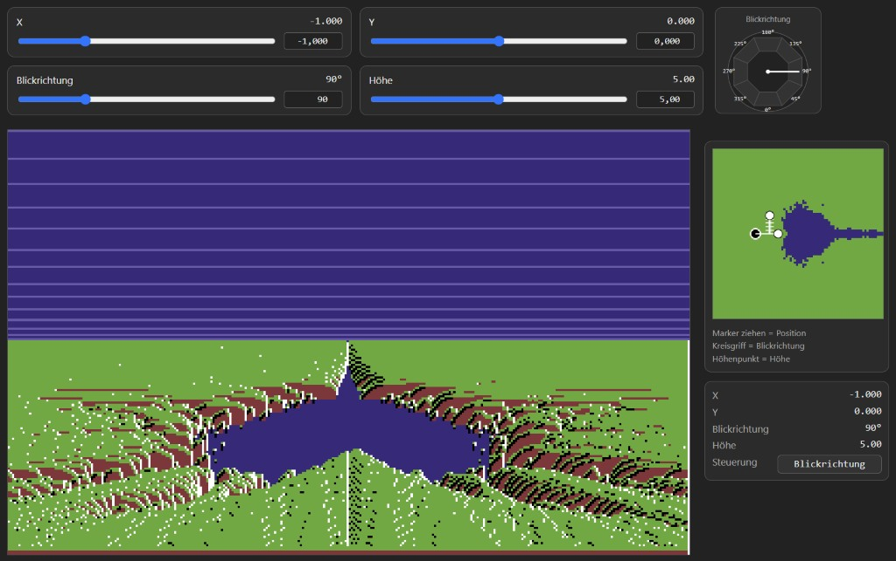
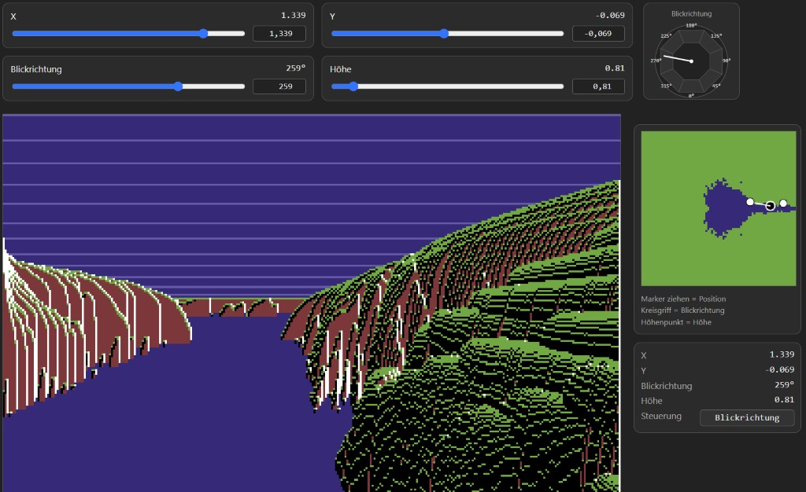
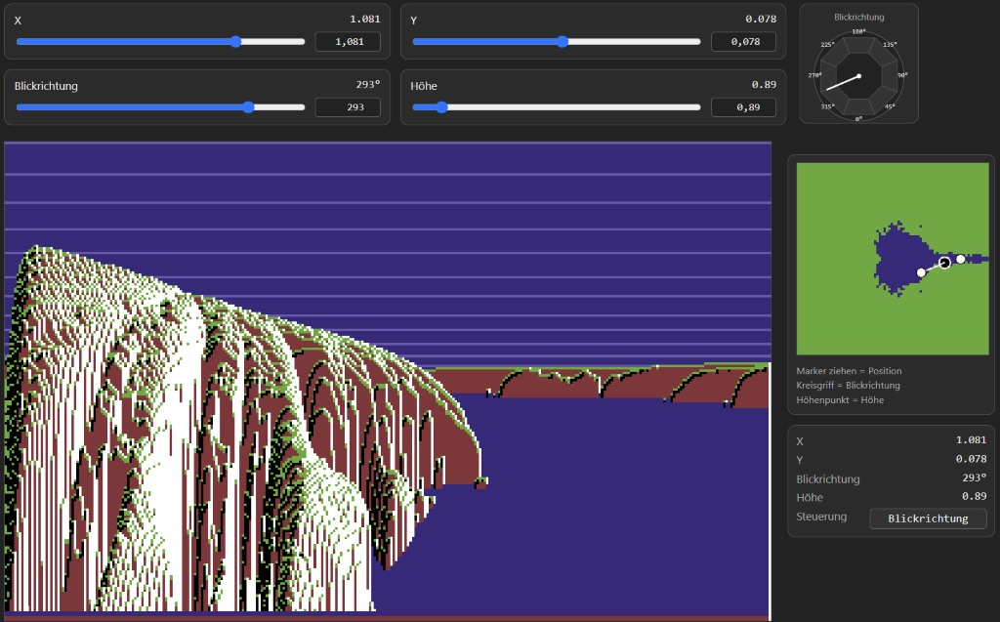

# Fraktalsee: Eine fantastische Reise – Vom Fraktal zur C64-Landschaft

Eine moderne HTML-/Canvas-Portierung eines Programms zur Darstellung fraktaler Landschaften, das ursprünglich 1987 als Commodore-64-BASIC-Listing in der deutschen Computerzeitschrift *Happy Computer* veröffentlicht wurde.

Das Programm erzeugt eine pseudo-3D-Landschaft mit einem See, basierend auf einem Mandelbrot-artigen Iterationsverfahren. Knapp vier Jahrzehnte später lässt sich diese Landschaft direkt im Webbrowser erkunden – ganz ohne C64, Joystick oder Supercomputer.

## Ein Stück Computergeschichte

Das ursprüngliche Listing erschien in der Ausgabe 6/87 der legendären deutschen Computerzeitschrift *Happy Computer*. Scans alter Ausgaben findet man heute unter anderem in Online-Archiven wie [Archive.org](https://archive.org/) oder [Kultpower.de](https://www.kultpower.de/).

Die vielen `DATA`-, `POKE`- und `SYS`-Befehle implementieren zu großen Teilen Grafikfunktionen in Maschinensprache. Diese Details müssen uns für die mathematische Betrachtung zunächst nicht weiter interessieren: In der modernen Portierung übernimmt HTML Canvas das Zeichnen.

Das damalige BASIC V2 des C64 besaß keine komfortablen Grafikbefehle. Eine vollständige Umsetzung der Grafikberechnungen in BASIC wäre zudem viel zu langsam gewesen.

Der ursprüngliche Artikel stellte auch die Leistungsfähigkeit unterschiedlicher Rechnergenerationen gegenüber. Auf einem 8-Bit-Heimcomputer wie dem C64 konnte die Berechnung eines einzigen Bildes mehrere Stunden dauern. Eine 16-Bit-Maschine wie der Amiga oder Atari ST schaffte es bereits in wenigen Minuten. Der Autor scherzte damals sinngemäß, dass jeder, der zufällig einen Cray-Supercomputer besitze, unbedingt einmal versuchen sollte, mit dem Joystick durch die Landschaft zu fliegen.

Heute genügt dafür ein moderner Webbrowser.

## Reverse Engineering eines alten BASIC-Listings

Besonders faszinierend ist, wie viel mathematische Komplexität in einem solchen alten Listing auf engstem Raum untergebracht sein kann.

Die Entwickler der 8-Bit-Ära mussten mit sehr begrenztem Speicher und geringer Rechenleistung auskommen. Code wurde komprimiert, Ausdrücke wurden vereinfacht, Variablen hießen schon einmal `X9`, und statt klar strukturierter Funktionen sprang das Programm zwischen Zeilennummern hin und her. Mathematische Verfahren wurden zudem häufig durch Ausprobieren und schrittweise Anpassungen so lange verändert, bis das gewünschte visuelle Ergebnis entstand.

Das Resultat ist aus heutiger Sicht nicht immer leicht zu verstehen. Hinter einer scheinbar willkürlichen Folge numerischer Berechnungen kann sich ein durchaus nachvollziehbarer mathematischer Prozess verbergen – ergänzt um zahlreiche historische Modifikationen, die im Laufe der Entwicklung hinzugekommen sind.

Moderne KI-Werkzeuge können bei diesem Reverse Engineering helfen. Sie unterstützen dabei, mathematische Interpretationen vorzuschlagen, Zusammenhänge sichtbar zu machen und aus schwer lesbarem Quellcode die zugrunde liegenden Verfahren herauszuarbeiten. Solche Interpretationen müssen allerdings am tatsächlichen Programmcode und seinem Verhalten überprüft werden.

Ein wesentlicher Bestandteil dieses Projekts ist deshalb nicht nur, das alte Programm neu zum Laufen zu bringen, sondern auch zu verstehen, wie es funktioniert, und die dahinterliegende Mathematik nachvollziehbar zu erklären.

## Die moderne Portierung

Das ursprüngliche BASIC-Programm wurde mit JavaScript und HTML Canvas neu umgesetzt. Der Browser übernimmt die grafische Darstellung und macht die Landschaft auf modernen Systemen zugänglich – ganz ohne die ursprüngliche Hardware.

Das Ziel ist dabei sowohl praktisch als auch explorativ: ein faszinierendes Stück Heimcomputer-Geschichte zu bewahren, seine mathematischen Grundlagen zu untersuchen und das Ergebnis allen zugänglich zu machen, die sich für Fraktale, Algorithmen und die kreative Ingenieurskunst der frühen Heimcomputer-Ära interessieren.

|                                                                    |                                                                    |
|--------------------------------------------------------------------|--------------------------------------------------------------------|
|  |  |

## Die beiden Primer

Dieses Projekt enthält zwei sich ergänzende Primer, die sich dem ursprünglichen Programm aus unterschiedlichen Richtungen nähern.

### 1. Vom Code zur Mathematik

[Primer: Vom Code zur Mathematik](Primer_Code_To_Math.md)

Was bedeutet eine bestimmte Codezeile mathematisch – und warum steht sie dort?

Dieser Primer geht **vom vorhandenen Quellcode rückwärts**: Ausgehend vom ursprünglichen BASIC-Listing und seiner JavaScript-/Canvas-Portierung werden die mathematischen Zusammenhänge rekonstruiert, die sich hinter der zunächst kryptisch wirkenden Implementierung verbergen.

Im Mittelpunkt steht die Frage, wie die einzelnen Berechnungen funktionieren und wie sie zum fertigen Bild beitragen.

### 2. Von der Mandelbrot-artigen Iteration zur pseudo-3D-Fraktallandschaft

[Primer: Von der Mandelbrot-artigen Iteration zur pseudo-3D-Fraktallandschaft](Primer_Fraktal_Pseudo_3D.md)

Dieser Primer geht den umgekehrten Weg. Ausgehend von den mathematischen Grundlagen erklärt er, wie sich ein Mandelbrot-artiges Iterationsverfahren zur Erzeugung einer Landschaft nutzen lässt, die den Eindruck einer dreidimensionalen Welt vermittelt.

Dabei werden die Mathematik des ursprünglichen Programms und ihre Umsetzung in der modernen JavaScript-/Canvas-Portierung miteinander verknüpft.

Eine gewisse Überschneidung zwischen beiden Primern lässt sich nicht vermeiden. Der Primer „Vom Code zur Mathematik“ entstand später, um einige Details des Quellcodes genauer zu untersuchen. Wer an einer Stelle nicht weiterkommt, findet im jeweils anderen Primer möglicherweise eine andere oder ergänzende Erklärung. Reinschauen lohnt sich also! ;-)
